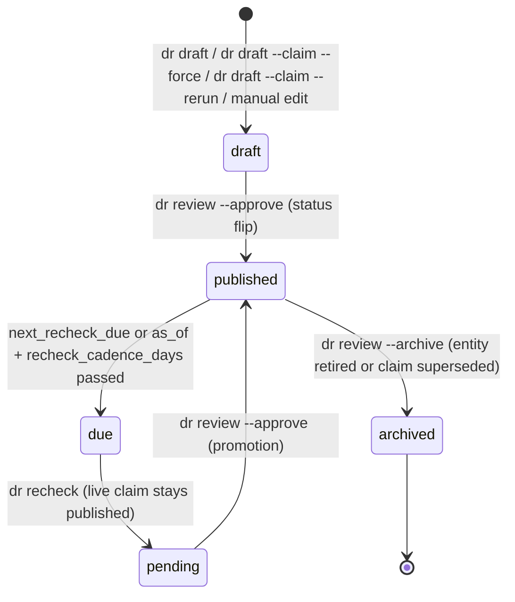
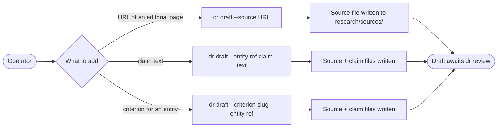
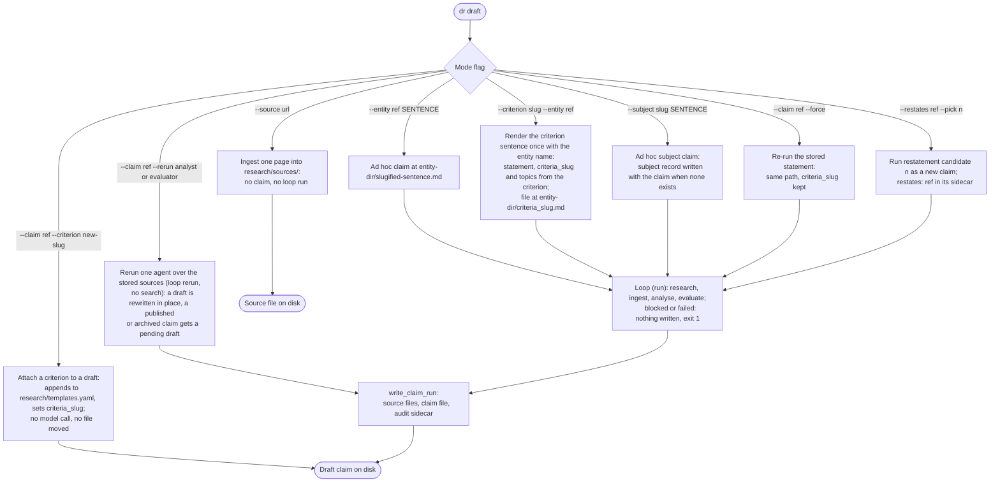
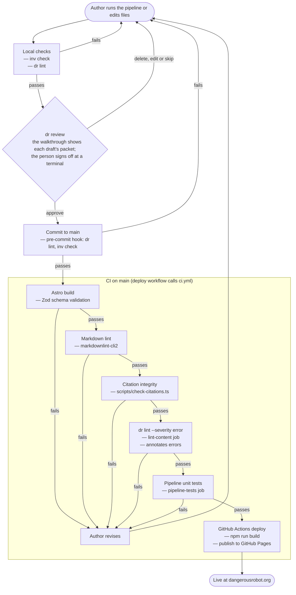

# Research Flow Diagrams

Visual reference for the research lifecycle. The first diagram is a state machine covering a claim from draft to archival. The remaining diagrams zoom into specific mechanisms: how work enters, pipeline execution, the draft commands that start a claim, and the sign-off path from local checks through `dr review` and the commit to CI and deploy.

Sections:

1. Claim lifecycle (state machine)
2. How work enters
3. Pipeline execution (sequence)
4. Draft commands
5. Sign-off without a PR

---

## 1. Claim lifecycle

Every claim moves through the same set of states regardless of how it was initiated (`dr draft` or a manual edit). Transitions are driven by pipeline events, a person's sign-off in `dr review`, or time-based staleness.



Notes:

- `draft` covers both pipeline-written files awaiting sign-off and hand-edited files not yet reviewed.
- The pipeline writes no placeholder claim: a run that fails the post-ingest threshold gate (fewer than 4 usable sources or a terminal fetch error), or whose analyst fails writes no claim file and no source file, and `dr draft` exits 1. A claim's status is `draft`, `published` or `archived`; any other value is a `dr lint` error (`invalid-claim-status`). A run that fails a step retries by rule (once for a flaw, twice with backoff for a transport error) and, when abandoned, recovered, split or partial (claim written, restater failed), leaves a finding under `research/findings/` (see [content-model.md](content-model.md#findings-file)).
- A published claim is due when its `next_recheck_due` has passed or, when it has none, when `as_of` plus `recheck_cadence_days` (default 60) has passed. The writer sets `next_recheck_due` on every claim write. `dr recheck --due --dry-run` lists the due claims, and `dr recheck --due` (or `--claim <ref>`) re-runs them. A rerun never touches the live claim: it lands as a pending draft under `research/pending/` (the `pending` state above, outside the site's claims loader) and the live page stays up until `dr review --approve` promotes it. No scheduler runs `dr recheck`; a person starts it (the scheduled job is a backlog item, see `docs/runbook.md` § Scheduled rechecks). `dr lint` also surfaces a past `next_recheck_due` as `info`. See [research-workflow.md § Citation Auditor tools](research-workflow.md#citation-auditor-tools).
- Archived claims remain in the repo but are excluded from published output.
- `draft → published` and `published → archived` transitions are driven by `dr review`, one claim at a time. See § 5 below for sign-off semantics, and [`docs/plans/completed/audit-trail.md`](../plans/completed/audit-trail.md) for the CLI contract.

---

## 2. How work enters

Work enters when the operator adds one of the non-claim objects or names a command. There is no queue file.



---

## 3. Pipeline execution

The core four-step pipeline as a sequence of messages between agents, with the blind tie-breaker that settles a disagreement and the restater that proposes candidate rewordings of a weak or tie-broken verdict. Ingestor calls run concurrently, one per URL returned by the Researcher. A source keeps only the key quotes found in the fetched text (body, title and meta description) of the requested page or its archive.org copy; the rest are dropped with a warning. A kept quote is stored without wrapping quotation marks or an attribution after them, since the source page shows each quote in a blockquote; the marks stay when they belong to the page text or the inner text alone is not on the page. A quote with an ellipsis must read as one excerpt: at most 300 characters of page text elided, at least three words between two ellipses, and at least two words in one fragment. The Evaluator role is implemented in `pipeline/auditor/`; the role and package names diverge intentionally in v1. The Evaluator grades the claim's `statement`, and the claim's `title` equals it: for `dr draft --criterion` the criterion's sentence rendered once with the entity name, otherwise the operator's sentence as typed. The analyst's title is not written. For a criterion-backed claim the analyst and the Evaluator both get the criterion's `grading_rule` (from `research/templates.yaml`) with the claim text, as grading guidance that is never cited as evidence; a rule's verdict mapping wins for its criterion, and `pipeline/common/verdict-scale.md` governs what the rule does not name. The criteria's `vocabulary` lists are site-only: the pipeline ignores them.

Ingest order and the listed sources:

- The Researcher ranks the URLs the scorer kept: pages on the entity's own website host first, then by the scorer's score, then by scorer position. A parent company's host gets no boost.
- A transport failure on one URL (a null body, a provider 5xx or 429, a dropped connection; not a timeout) is retried once for that URL before it is dropped from the pool.
- Cached sources never shrink the fresh-ingest target: when sibling claims already left sources on disk, the loop still tries `max_sources` fresh candidates. Cached sources only steer the order below.
- Before ingest the URLs are reordered so the sub-question with the fewest sources (dedup hits already on disk count) is filled first. Each pick takes that sub-question's first URL in ranked order, so an entity page that addresses only a well-covered sub-question can follow URLs for thinner ones. The candidate pool cut (`candidate_pool_size`) always keeps each sub-question's first two URLs and fills the rest in ranked order, so a thin sub-question's low-scored URLs stay in the pool.
- The ingest order still uses the scorer's tags, which come from search snippets. After ingest, the loop checks each tag against the page text: the fetched text of the requested page for a fresh source, the stored title, summary, quotes and body for a cached one. A tag whose page never mentions the sub-question's terms (its question and query words, minus stop words, the entity's name and any word that appears in two or more sub-questions' terms; a sub-question left with no terms keeps every tag) is dropped from that source's `addresses` and listed in the sidecar's `sub_questions[].snippet_only`.
- A sub-question that no ingested source addresses after that check is logged as a warning, which the console shows. The analyst prompt marks it (from the confirmed tags), and the narrative describes the gap in plain words without the sub-question id. The sidecar's `sub_questions[].citations` is empty for it. The counter-evidence sub-question is held to the same check.
- After the analyst, the claim lists only the sources it relied on: the ids in its `cited_sources`, the sources its own `source_overrides` name (the entity-match relabels do not count, but an analyst override the entity match corrects does), and the sources whose title the narrative names. Uncited fresh sources are not written. Every ingested source stays in the sidecar's `sources_consulted`.
- Every ingested source is listed when nothing is cited, or when the cited subset would support a lower `verification_level` than the full list (both checked with the level fit, which then runs on the listed sources before the Evaluator, so the Evaluator grades the fitted verdict).
- A source in the analyst's `cited_sources` whose title the narrative never names breaks the cite-by-title rule (`pipeline/analyst/instructions.md`). The loop does not drop it; the sidecar's `analyst_record.uncited_by_title` lists those ids.
- The Evaluator grades against the listed sources. When the analyst fails, or the run is blocked, nothing is written: no source file, no claim and no sidecar; the run's finding is the only record.
- A disagreement (the two verdicts differ; two evidence gaps alone never count) goes to the tie-breaker, which gets the Evaluator's blind bundle with a higher thinking budget, on the `--tiebreaker-model` slot (the run's `--model` unless `DR_TIEBREAKER_MODEL` is set; see the runbook's "Model slots"). A verdict that matches either side wins; a three-way split takes the weakest by `VERDICT_STRENGTH` with that side's confidence. The sidecar records all three sides, `pipeline_verdict` and `rule_applied`. A tie-breaker that fails after one retry abandons the run.
- A weak verdict (`pipeline_verdict` of `unverified`, `mixed` or `not-applicable`, even after the tie-breaker) or a tie-broken one goes to the restater, on the `--restater-model` slot (falls back to `--auditor-model`, then `--model`). It reads the claim statement, the pipeline verdict, the analyst's narrative as context only, the Evaluator's evidence gaps, the entity, and a pool: every source the run consulted plus the best-matching sources already in `research/sources/` (up to `restate_pool_size`, default 24). It proposes up to five candidate statements, each with the verdict the pool would give it, and is never given a thesis to prove, so a candidate may be strongly supported or strongly refuted: candidates are ranked by how decisively the evidence settles them in either direction. The same-entity rule drops a candidate that names none of the claim's entity names (the entity's own names plus any entity file the statement names). The loop checks each quoted passage against its source, caps the decisiveness of a candidate with no verified supporting quote, and writes one `restatement` block into the sidecar. The original statement stays as drafted; the operator may run a candidate as a new claim with `dr draft --restates`. A polar agreed verdict calls no restater and writes no block. A restater that fails after its retries never costs the run: the claim is written without the block and a `partial` finding is recorded.

```mermaid
sequenceDiagram
    actor Operator
    participant Researcher
    participant Ingestor
    participant Analyst
    participant Evaluator
    participant Tiebreaker as Tie-breaker
    participant Restater

    Operator->>Researcher: claim text + entity
    Researcher-->>Operator: candidate URLs (post-blocklist)

    par concurrent ingest per URL
        Operator->>Ingestor: URL 1
        Ingestor-->>Operator: SourceFile 1
    and
        Operator->>Ingestor: URL 2
        Ingestor-->>Operator: SourceFile 2
    and
        Operator->>Ingestor: URL N
        Ingestor-->>Operator: SourceFile N
    end

    alt below_threshold (< 4 usable sources)
        Operator-->>Operator: blocked_reason set, nothing written; return
    else proceed
        Operator->>Analyst: sources
        Analyst-->>Operator: AnalystOutput (verdict, narrative)

        Operator->>Evaluator: claim statement, analyst narrative, listed sources
        Evaluator-->>Operator: ComparisonResult (independent)

        alt verdicts differ
            Operator->>Tiebreaker: same bundle, blind
            Tiebreaker-->>Operator: IndependentAssessment; settle_verdict
        end

        alt weak or tie-broken verdict
            Operator->>Restater: statement, pipeline verdict, narrative, gaps, pool
            Restater-->>Operator: ranked candidates (sidecar restatement block)
        end
    end

    Operator-->>Operator: VerificationResult
```

---

## 4. Draft commands

Every claim reaches the loop through `dr draft`. The loop runs once per claim and the one writer (`write_claim_run`) writes it; an abandoned run leaves no claim, no source file and no subject record.



---

## 5. Sign-off without a PR

Research content is committed straight to `main`; no pull request stands between a draft and the live site. Sign-off is `dr review`, which a person runs at a terminal. Local checks run before it, the pre-commit hook runs at the commit, and CI runs on `main` before the site deploys. A rejection sends the author back to the first step.



Notes:

- `dr review` with no arguments walks the drafts awaiting sign-off. Each draft prints its review packet: the evidence parts first, then the verdict chain (the claim, the analyst, the Evaluator, the tie-breaker when one ran, the pipeline's verdict and the rule that set it) and the header facts directly above the key prompt. The `v` key opens the whole packet in `$PAGER`; `r` records a restatement pick; `a` approves. `dr review --format text|json` prints the packets and writes nothing.
- Human sign-off on a claim is recorded by `dr review` (writes `human_review` in the audit sidecar). `dr review --claim <ref> --approve` additionally flips `status: draft` to `status: published`, so sign-off and publish are a single operator step. `dr review --archive` retires a published claim. The sign-off needs a terminal and the typed claim slug; an agent never runs it. See [`docs/plans/completed/audit-trail.md`](../plans/completed/audit-trail.md) for the original CLI contract.
- `--approve` records a verdict that differs from the pipeline verdict in the sidecar (`audit.pipeline_verdict`, or `audit.analyst_verdict` on a sidecar written before it existed) as `human_review.verdict_override`, with the reviewer. It refuses a refreshed claim whose verdict changed unless a one-line `--correction` is given. No command publishes without recording a reviewer.
- A forced rewrite (`dr draft --claim --force`, `dr draft --force`) of a published or archived claim is refused with a pointer to `dr recheck --claim <ref>`; only a draft is overwritten in place. `dr recheck` (or `dr draft --claim <ref> --rerun analyst|evaluator`) writes the rerun as a pending draft, which `dr review` lists under the live claim's ref with a header saying whether the verdict changed. On `--approve` the pending files move over the live ones (the writer takes the refresh snapshot, with `dropped_sources`, at that moment) and the same approval completes the sign-off and closes the `refresh` block. Approving a changed verdict requires a one-line correction, which becomes a `corrections` entry on the claim page. Steps: `docs/runbook.md` § Refreshing a published claim.

---

## 6. Researcher internals (decomposed path)

The Researcher is implemented as a decomposed pipeline (planner → search executor → scorer; there is no monolithic mode). The Researcher participant in diagram 3 internally runs the sequence below. The dispatch step fans out across `research_origins` (default `["tavily", "arxiv"]`); the web origin is powered by `search_backend` (`tavily` default, `brave` fallback) and arXiv fires only when the claim's topics intersect `ACADEMIC_TOPICS` (`ai-safety`, `environmental-impact`, `industry-analysis`). All LLM calls are guarded by the `llm_concurrency` semaphore.

```mermaid
sequenceDiagram
    participant Orchestrator
    participant QueryPlanner as Query Planner (Haiku)
    participant Web as Web Search (Tavily default; Brave fallback)
    participant ArXiv as arXiv API (academic origin)
    participant URLScorer as URL Scorer (Haiku)

    Orchestrator->>QueryPlanner: claim text + entity context (name, parent_company if set)
    Note over QueryPlanner: structured output, no tools
    QueryPlanner-->>Orchestrator: QueryPlan (2-5 coverage sub-questions plus one counter-evidence sub-question that asks what would falsify the claim, each with queries; rationale)

    Note over Orchestrator: hard-truncate to max_initial_queries; select origins per claim topics

    par web origin (per query, asyncio.gather)
        Orchestrator->>Web: query 1
        Web-->>Orchestrator: results 1
    and
        Orchestrator->>Web: query N
        Web-->>Orchestrator: results N
    and academic origin (only if topics ∩ ACADEMIC_TOPICS ≠ ∅)
        Orchestrator->>ArXiv: claim-derived query
        ArXiv-->>Orchestrator: paper candidates
    end

    Note over Orchestrator: merge web + academic candidates; deduplicate by exact URL string; classify each web candidate with publisher_quality label (primary/secondary/tertiary/forum). Academic candidates carry origin=arxiv on the audit sidecar.

    Orchestrator->>URLScorer: claim + entity context (name, parent_company if set) + candidates (title, snippet, publisher_quality)
    Note over URLScorer: structured output, no tools
    URLScorer-->>Orchestrator: ScoredURLs (kept ≥ 3 on at least one sub-question, dropped < 3)

    Note over Orchestrator: if kept=[] (drop-all), return empty URL list; run blocked as insufficient_sources, nothing written

    Orchestrator-->>Orchestrator: apply max_sources cap, blocklist filter
```
